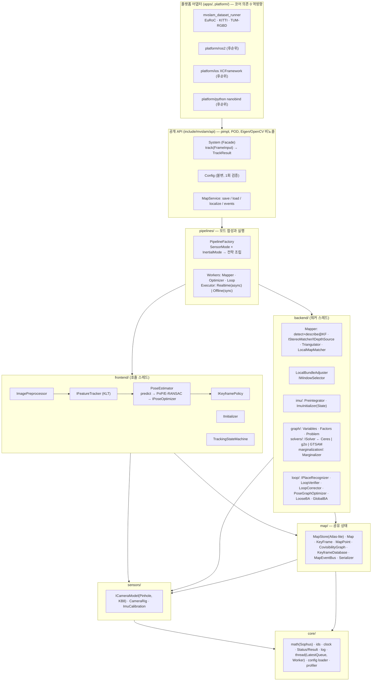
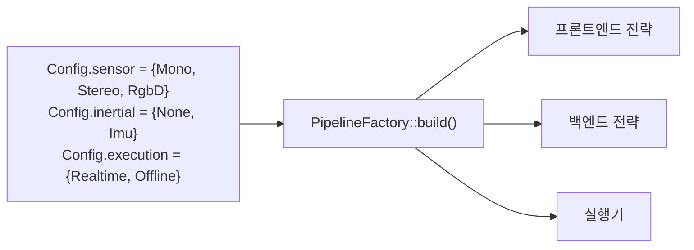

# 01 — 아키텍처: 계층, 모듈, 데이터 흐름

## 1. 계층 다이어그램



### 의존 방향 규칙 (컴파일 타임에 강제: CMake 타깃 링크 + include 검사)
- `core ← sensors ← map ← {frontend, backend} ← pipelines ← api ← {apps, platform}`.
- **frontend ↔ backend 직접 의존 금지.** 프론트엔드가 필요로 하는 최적화(motion-only BA, pose-inertial)는 `frontend/IPoseOptimizer` 인터페이스로 선언하고 `backend/`가 구현해 `pipelines/`가 주입한다(Dependency Inversion). 백엔드 결과는 `map/`을 통해서만 프론트엔드에 도달한다(ORB의 `mbMapUpdated` 대신 `Map::changeEpoch()`).
- 공개 헤더(`include/mvslam/api`)는 표준 라이브러리 타입만 노출한다. Eigen·Sophus·OpenCV는 `src/` 내부 전용. `ImageView{data, width, height, stride, format}` POD로 이미지를 받는다(cuVSLAM `Image`).
- 서드파티 헤더는 해당 모듈 안에서만 include한다: OpenCV는 `frontend/`·`backend/mapper/`·`apps/`, Ceres/g2o/GTSAM은 `backend/solvers/<lib>/`, cereal은 `map/serialization/`, yaml-cpp는 `core/config/`.

## 2. 모드 합성 (Factory) — `if(mode==…)` 산재 금지



| 슬롯(지침서 §3) | 전략 인터페이스 | Mono | Stereo | RgbD | +Imu(데코레이션) |
|---|---|---|---|---|---|
| ① 측정 추출(프레임) | `IFeatureTracker` | `KltTracker`(좌 영상) | 동일(좌만) | 동일(컬러/그레이) | — |
| ① 측정 추출(KF) | `IFeatureDetector`+`IDescriptorExtractor` | `GridShiTomasi`+`Orb`(KF) | 동일 | 동일 | — |
| 깊이 소스(KF) | `IDepthSource` | `NoDepth` | `KltStereoMatcher`(좌→우 KLT, 에피폴라 2 px) | `DepthImageSource`(가상 baseline 불확실성) | — |
| ② 자세 예측 | `IPosePredictor` | `ConstantVelocity` | 동일 | 동일 | `ImuPredictor`(preintegration, KF/프레임 앵커 규칙) |
| ③ 연관 | `LocalMapAssociator` | 투영 + KLT 트랙 id ↔ MP id | 동일 | 동일 | 탐색 반경 상태별 |
| ④ 자세 최적화 | `IPoseOptimizer` | `MotionOnlyBA`(Huber χ²95%, 2-pass) | 동일 | 동일 | `PoseInertialOptimizer`(15-D prior, CASE A/B) |
| 초기화 | `IInitializer` | `TwoViewHF`(H/F 병렬, ORB) | `StereoDepthInit`(첫 KF 즉시 MP) | `DepthInit` | + `ImuInitializer`(상태기계) |
| KF 판정 | `IKeyframePolicy` | `ParallaxAndTrackRatio`(OV²SLAM) | + close-point 규칙(ORB) | + close-point | + 시간 조건 0.5 s / 초기화 전 0.25 s |
| ⑤ 로컬 BA 윈도우 | `IWindowSelector` | `CovisibilityWindow(cap)` | 동일 | 동일 | `TemporalWindow(N=10/25)` |
| ⑥ 과거 상태 | `KeyframeCuller` + `PriorFactory` | culling 0.9 | culling 0.9 | culling 0.9 | culling 0.9(mono-I)/0.5(stereo-I) + 시간 제약 |
| ⑦ 루프 보정 | `ILoopCorrector` | `Sim3Corrector` | `Se3Corrector` | `Se3Corrector` | `Yaw4DofCorrector`(IMU 초기화 후) |
| ⑧ 관성 | `Preintegrator`, `ImuInitializer` | — | — | — | mono: scale 변수 / stereo·rgbd: scale 고정 |

상수 기본값은 [02-frontend.md](02-frontend.md)·[03-backend.md](03-backend.md) 표와 `configs/*.yaml`(모드별 프리셋 — OV²SLAM 6-노브 방식)에 있다.

## 3. 데이터 흐름

### 3.1 프레임 1장 (호출 스레드, Template Method `VisualFrontend::process`)
```
FrameInput(timestamp, images[cam], imu samples) 
 → preprocess(CLAHE 옵션, 피라미드; 이전 피라미드 swap 재사용)
 → predictPose()         IPosePredictor (등속 | IMU)
 → track()               IFeatureTracker: 3D 트랙(투영 초기값, 2레벨) → 실패분+2D 트랙(4레벨), fb-check
 → filterOutliers()      E-RANSAC(parallax>6 px일 때만; stereo 3D→E→2D)
 → estimatePose()        (3D 트랙 생존율<33% 또는 실패 시 P3P-RANSAC) → IPoseOptimizer
 → updateState()         TrackingStateMachine(OK / RECENTLY_LOST / LOST → 새 맵)
 → decideKeyframe()      IKeyframePolicy(+ 백엔드 부하 역압)
 → [KF] enqueue KeyframeRequest{frame 복사, 피라미드, 우/깊이 영상, preintegration}
 → TrackResult{T_wb, v, bias, state, n_tracks, kf_id?}
```

### 3.2 키프레임 경로 (Mapper 워커 → Optimizer 워커 → Loop 워커)
```
Mapper:    detect(빈 격자 셀) → describe(ORB@KF) → depth(IDepthSource) → triangulate(temporal+stereo)
           → covisibility 갱신 → localMapMatch(투영+descriptor 최소거리, 선점 가능) → MapPoint 병합
           → publish(KeyframeInserted) → Optimizer 큐(최신만 유지, 버린 KF id는 covisibility 합류)
Optimizer: ImuInitializer.step() (관성) → LocalBA(IWindowSelector, 시간 상한, 선점) → outlier 제거
           → MapPointCuller → KeyframeCuller(anchor 이전, preintegration 병합) → publish(MapPointsUpdated)
           → Loop 큐(최신만)
Loop:      IPlaceRecognizer.query → LoopVerifier(5단+공간 3표) → ILoopCorrector(Sim3|SE3|4DoF 전파, ρ/s)
           → PoseGraphOptimizer(essential graph) → LooseBA(오차≥θ일 때만) → [옵션] GlobalBA(지연 적용)
           → publish(PosesCorrected{kf_id → ΔT}) — dense mapping 훅
```

### 3.3 맵 재사용
```
MapService.load(path) → MapStore에 stored 맵 추가 → Relocalizer가 모든 맵의 KeyframeDatabase를 질의
 → 성공: 해당 맵을 active로 전환(IMU 상태 승계) / 실패: 새 맵 시작, Loop 워커가 병합(ORB Atlas)
```

## 4. 디렉터리 구조와 명명

```
MVSLAM/
├─ include/mvslam/api/       공개 API: types.hpp config.hpp system.hpp map_service.hpp version.hpp
├─ include/mvslam/c/         C ABI (후순위)
├─ src/core/                 math/ ids/ clock/ status/ log/ thread/ config/ profiler/
├─ src/sensors/              camera_model, camera_rig, imu_calibration, rectification
├─ src/map/                  frame, keyframe, map_point, covisibility_graph, map, map_store, keyframe_database, map_events, serialization/
├─ src/frontend/             preprocess/ tracking/ detection/ pose/ keyframe/ init/ state/ visual_frontend
├─ src/backend/              graph/ solvers/{ceres,g2o,gtsam}/ marginalization/ imu/ mapper/ local_ba/ loop/
├─ src/pipelines/            pipeline_factory, workers, executor
├─ src/api/                  공개 API 구현(pimpl)
├─ apps/                     mvslam_dataset_runner
├─ platform/                 ros2/ ios/ python/ (self-gating)
├─ tests/{unit,integration,fixtures}   bench/
├─ configs/                  모드별 yaml 프리셋
├─ third_party/              서브모듈(태그 고정)  cmake/  docker/  scripts/  docs/{design,adr}
```
- 파일 = 클래스 1개 원칙, `snake_case.hpp/.cpp`, 클래스 `PascalCase`, 인터페이스 `I` 접두, 멤버 `snake_case_`. 네임스페이스 `mvslam::{core,sensors,map,frontend,backend,pipelines}`.
- 헤더 상단에 **역할·스레드 소유·불변식** 3줄 주석을 둔다(ORB의 갓 클래스 재발 방지 — `Tracking.cc` 4,126줄·`Optimizer.cc` 5,590줄이 반면교사).

## 5. 스레드 요약 (상세 [06-concurrency.md](06-concurrency.md))
| 스레드 | 소유 | 큐 | 중단/역압 |
|---|---|---|---|
| 호출 스레드 | 프론트엔드 전체, `TrackResult` 반환 | 입력은 호출자가 공급(내부 큐 없음 — Realtime에서 호출자가 늦은 프레임을 drain하도록 `System::track`은 논블로킹) | 백엔드 부하 신호로 KF 억제 |
| Mapper | KF 측정 추출·삼각측량·로컬맵 매칭 | `LatestQueue<KeyframeRequest>` | 새 KF 도착 시 로컬맵 매칭 조기 종료 |
| Optimizer | IMU 초기화, LBA, culling | `LatestQueue<KeyframeId>`(버린 id 합류) | BA 선점(`StopToken`) + 시간 상한 |
| Loop | place recognition, 보정, PGO, loose BA, GBA | `LatestQueue<KeyframeId>` | GBA 중단 + 지연 적용, retention window |

## 6. 공개 API 요약 (상세 [05-api-config.md](05-api-config.md))
```cpp
mvslam::Config cfg = mvslam::Config::fromYaml("configs/euroc_stereo_imu.yaml"); // 검증 실패 → throw
mvslam::System slam(cfg);                       // 파이프라인 합성, 워커 기동(Realtime) 또는 동기(Offline)
slam.pushImu(ImuSample{...});                   // 시간 단조 증가 필수(외부 직렬화)
auto r = slam.track(FrameInput{t, {imgL, imgR}}); // 논블로킹, TrackResult(optional pose)
slam.mapService().save("map.mvs");              // 비동기 + 콜백(Result)
```
