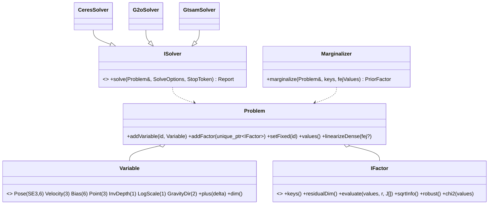

# 03 — 백엔드 설계 (워커 스레드)

> 핵심 결정: **factor가 수식을 소유, 솔버는 어댑터**(`분석/10` §1·§8). 이로써 Ceres(1차)·g2o·GTSAM을 같은 `Problem`으로 풀 수 있고, marginalization·FEJ를 라이브러리와 무관하게 구현하며, 모든 Jacobian을 수치 미분과 대조하는 단위 테스트를 둔다.

## 1. 그래프 추상 (`src/backend/graph/`)

### 1.1 변수(Variable)와 manifold
| 종류 | 표현 | 증분 | 비고 |
|---|---|---|---|
| `Pose` | `Sophus::SE3d T_wb` | **우측 곱** `T ← T·exp(δ)`, δ=[ρ, φ] (body frame) | ORB `ImuCamPose::Update`와 동일 관례; 카메라 pose는 `T_wc = T_wb·T_bc` 파생. 규약을 **하나로 통일**(`분석/05` §3-1) |
| `Velocity` | `Vector3d v_w` | 가법 | |
| `Bias` | `Vector6d [b_g, b_a]` | 가법 | ORB의 3+3 분리 정점을 6-D 하나로(`분석/05` §3-4) |
| `Point` | `Vector3d X_w` | 가법 | 정본 |
| `InvDepth` | `double ρ` (anchor KF, 픽셀 u,v 고정) | 가법 | BA 파라미터화 전용(OV²SLAM), 결과는 XYZ로 환원 |
| `LogScale` | `double σ`, `s = exp(σ)` | 가법 | ORB `VertexScale`의 "승산 갱신 vs 가산 Jacobian" 불일치 결함(ORB_SLAM3_Modern P6-3 실측: s*≥2 발산)을 **정의로 제거** — 잔차 Jacobian은 항상 `∂r/∂σ = ∂r/∂s·s` |
| `GravityDir` | `SO3 R_wg`, 2-DoF 증분 `exp([δ1, δ2, 0])` | 좌측 | ORB `VertexGDir` |

### 1.2 Factor 목록 (`분석/05` 대응표의 MVSLAM 열)
| Factor | 잔차 | 키 | 비고 |
|---|---|---|---|
| `ReprojectionFactor` | 2 (u,v) | Pose(host), Point | 카메라 `cam_idx`, `ICameraModel::projectJac`; Σ = 관측 info |
| `AnchoredInvDepthFactor` | 2 | Pose(anchor), Pose(obs), InvDepth | anchor 자신의 관측은 잔차 없음; 우측 카메라 관측은 `cam_idx`로 같은 factor |
| `ReprojectionPoseOnlyFactor` | 2 | Pose | motion-only, 점은 상수 |
| `ImuFactor` | 9 (Δr, Δv, Δp) | Pose_i, Vel_i, Bias_i, Pose_j, Vel_j | ORB `EdgeInertial` 수식(`분석/10` §7), 정보 = `C⁻¹` PSD 사영; **재적분 임계** 옵션(cuVSLAM) |
| `ImuScaleGravityFactor` | 9 | + LogScale, GravityDir | 초기화 전용(ORB `EdgeInertialGS`); scale은 위치·속도 차에만 곱함 |
| `BiasRandomWalkFactor` | 6 | Bias_i, Bias_j | 정보 = RW 공분산⁻¹ |
| `BiasPriorFactor` | 6 | Bias | 초기화 staged prior(1e2/1e10·1e5 → 1/1e5 → 0) |
| `PriorFactor` | n | 임의 키 집합 | marginalization 결과: `r = L·(x ⊟ x0)`, `H = LᵀL`(PSD 사영, FEJ x0) |
| `RelativePoseSE3Factor` | 6 | Pose_i, Pose_j | PGO(stereo·rgbd·VI 4-DoF 변형) — `(I+½ad)·Adj` Jacobian(OV²SLAM) |
| `RelativePoseSim3Factor` | 7 | Sim3_i, Sim3_j | mono PGO(essential graph, 정보 I) |
| `Yaw4DofFactor` | 6 | Pose_i, Pose_j | roll/pitch 증분 0(ORB 4DoF) |
| `Sim3ReprojectionFactor` | 2 | Sim3 | loop 검증 양방향(ORB `OptimizeSim3`) |

각 factor는 **해석 Jacobian**을 구현하고 `tests/unit/test_factor_jacobians.cpp`가 수치 미분(중앙차분)과 1e-6 상대오차로 대조한다. `robust()`는 `{None, Huber(δ), Cauchy}`; 관성 factor는 기본 None(ORB·DM-VIO 관례), 경계 factor만 Huber √16.92 + 정보 ×1e-2(ORB LocalInertialBA).

### 1.3 솔버 어댑터 (`src/backend/solvers/`)
| 어댑터 | 매핑 | 구성 |
|---|---|---|
| `CeresSolver`(1차, 필수) | `IFactor` → `ceres::CostFunction`(동적 크기, `Evaluate`가 `evaluate` 호출), `Pose` → `ceres::Manifold`(SE3 우측 증분, `PlusJacobian=[I;0]` 방식), `LogScale/GravityDir` → Manifold; 고정 키 → `SetParameterBlockConstant`; 점 → `ParameterBlockOrdering` group 0 | `SPARSE_SCHUR`/`DENSE_SCHUR`/`DENSE_QR`/`SPARSE_NORMAL_CHOLESKY` 선택, LM, `max_solver_time`, `IterationCallback`으로 `StopToken` 반영, `LossFunctionWrapper` → `Reset(nullptr)` 2-pass |
| `G2oSolver`(옵션) | `IFactor` → `g2o::BaseMultiEdge<Dynamic>`(`computeError`/`linearizeOplus`가 `evaluate` 호출), `Variable` → `BaseVertex<D, T>` | `BlockSolverX` + `LinearSolverEigen`, LM/GN, `setForceStopFlag` |
| `GtsamSolver`(옵션) | `IFactor` → `gtsam::NonlinearFactor` 파생(`linearize`가 `evaluate`로 `JacobianFactor` 구성), `Variable` → `Values`(Pose3·Vector·custom LieGroup) | `LevenbergMarquardtOptimizer`; `Marginals`로 공분산 질의 가능 |
등가성 검증: 같은 `Problem`을 세 어댑터로 풀어 GT 복구 정확도(해석적 정답)로 판정, 어댑터 간 비교는 통계 봉투(ORB_SLAM3_Modern P12-G0-2 방법론).

### 1.4 Marginalizer (`src/backend/marginalization/`)
1. `Problem::linearizeDense(fej_values)`: 각 factor의 `evaluate`로 J,r → `H = ΣJᵀΣJ`, `b = ΣJᵀΣr`(marg 키 포함 factor만, Markov blanket).
2. 재배열(marg 키 먼저) → `sqrt(|diag|+10)` preconditioning → `H_mm⁺`(고유값 클램프 유사역행렬) → Schur → 대칭화 → PSD 사영(ORB `ConstraintPoseImu`·DM-VIO `computeSchurComplement` 동일 계보, `분석/10` §4-6).
3. 결과 `PriorFactor(keys, H, b, x0=fej)` — 이후 선형화점 이동은 `b − H·(x ⊟ x0)`.
사용처: (a) pose-inertial 추적의 직전 프레임 15-D prior(ORB), (b) VIO 전용 모드의 슬라이딩 윈도우(dm-vio; 옵션), (c) 관성 LBA 경계(현재는 ORB식 다운웨이트 — prior로 교체하는 것은 실험 항목).

## 2. Local BA (`src/backend/local_ba/`)
| 항목 | 설계 |
|---|---|
| 윈도우 전략 `IWindowSelector` | `CovisibilityWindow{max_kf=20}`: 현재 KF + covisible KF(공유 ≥ 15) 상위 N, 나머지 관측 KF 고정(ORB — **상한 추가**, `분석/00` "시각 LBA 상한 없음"); `CovScoreWindow{min_cov=25}`: OV²SLAM 정렬 순회 절단; `TemporalWindow{N=10, N_large=25, max_fixed_visual=200}`: 관성(ORB) |
| 점 파라미터화 | 설계: `AnchoredInvDepth`(anchor = 최초 관측 KF; 윈도우 밖 anchor면 XYZ). **P0 구현은 XYZ**(`backend.anchored_inverse_depth` 키는 예약, 관성 단계에서 도입) |
| 솔버 옵션 | `SPARSE_SCHUR`, LM, 시각 10 iter / 관성 10(large 4), **시간 상한 0.2 s**, `StopToken`(새 KF 도착 시 Mapper가 신호) |
| robust/outlier | Huber χ² 5.991(mono)/7.815(stereo) → 제거 → L2 재정련(옵션) → 2차 제거; 관성 factor kernel 없음 |
| 발산 감지 | 전후 **robust 비용**(Huber 적용값) 비교, 5% 이상 악화 시 결과 폐기(ORB `LocalInertialBA`). 순수 χ²로 비교하면 outlier 하나가 `inf`를 만들어 가드가 무력화된다(P0 실측) |
| 사전 필터 | 스냅샷 시 어떤 관측 KF에서든 depth ≤ 0인 관측은 문제에 넣지 않고 outlier로 기록(write-back에서 관측 제거, 관측 < 2면 MP 제거). Ceres는 초기 잔차 평가가 실패하면 반복을 시작하지 않고 종료하므로(`Initial residual and Jacobian evaluation failed`) 이 필터 없이는 점 하나가 LBA 전체를 무효화한다 |
| write-back | 최적화는 사본으로, 결과는 `Map::withWriteLock`에서 일괄 반영 + `changeEpoch++` + `MapPointsUpdated` 이벤트 |

## 3. Mapper (`src/backend/mapper/`)
- 처리 순서(`Mapper::process`, write lock 1회): (초기 맵이면 첫 KF·점 삽입) → KF 삽입·prev/next 연결 → 키포인트마다 `Map::resolveTrack`(alias 반영)으로 MP 조회 → 기존 MP면 관측 추가 + descriptor 갱신 / depth > 0이면 즉시 MP / 아니면 pending 2-D 관측 등록 후 temporal 삼각측량 → covisibility → `LocalMapMatcher` → MP culling.
- 삼각측량(temporal): pending 관측 중 **가장 오래된 KF와 새 KF**의 두 광선 최근접 중점, parallax ≥ `triangulation_min_parallax_deg`(1°), 양쪽 재투영 ≤ `triangulation_max_reproj_px`(3 px), depth > `min_depth_m`. 성공 시 pending 관측 전부를 관측으로 등록(anchor = 최초 관측 KF). 10 KF 넘게 잠든 pending 트랙은 폐기. 깊이 소스(stereo/rgbd)가 있는 트랙은 즉시 MP.
- `LocalMapMatcher`(KF 시점, write lock 안): 로컬 KF = 새 KF의 covisible 상위 `local_match_max_keyframes`(20) ∪ prevKf 체인 3개; 이들이 보는 MP 중 새 KF가 관측하지 않는 것을 새 KF pose로 투영 → 반경 `local_match_radius_px`(5) 안의 **미추적 키포인트**(2-D 트랙, 기술자 있음)와 ORB Hamming 최소거리 ≤ `local_match_max_hamming`(50), 2위 대비 ratio 0.8, 키포인트당 1 MP. 채택 시 (a) 관측 추가, (b) **트랙 alias**(2-D 트랙 id → 기존 MP id)를 맵에 기록 — 프론트엔드가 다음 프레임 `refreshTracksFromMap`에서 살아 있는 KLT 트랙 id를 바꿔 이어 붙이고(`TrackId ≡ MapPointId` 규약을 지키는 병합 수단), Mapper는 이후 KF에서 같은 트랙을 중복 삼각측량하지 않는다, (c) 그 트랙의 pending 2-D 관측 중 재투영 ≤ 3 px인 것을 MP 관측으로 **이관**. 실측(MH01 stereo Offline): ATE 0.047 → 0.032 m.
- MP culling: 생성 후 `mp_cull_grace_keyframes`(3) KF가 지난 시점에 관측 < `mp_cull_min_observations`(2)면 제거. (found ratio 기준은 프론트엔드가 로컬맵 MP를 프레임마다 재투영하지 않으므로 P0에서는 정의되지 않음.)
- `KeyframeCuller`(ORB 규칙: 새 KF의 covisible 중, 점의 `kf_cull_redundancy` 90%(stereo-I 50%)가 다른 ≥ `kf_cull_min_other_observers`(3) KF에서 관측되면 제거; 직전 KF 이후 전부·맵 origin 보호). **기본 OFF**(`backend.kf_culling: false`, [ADR-0009](../adr/0009-keyframe-culling-off-for-klt.md)): KLT 트랙은 연속 KF 10여 개에서 관측되므로 이 규칙은 거의 모든 KF를 잉여로 판정한다 — MH01 stereo에서 670 KF 중 28개만 남고 ATE 0.032 → 0.257 m. 제거 시 관측이 < 2로 떨어진 MP도 함께 제거(ORB `EraseObservation` 의미론), culled KF는 **참조 KF(spanning tree 부모) 기준 상대 pose 기록**을 남겨 궤적 재구성이 백엔드 보정을 계속 따른다(ORB `mTcp`). 관성 규칙(간격 < 3 s, `mergePrevious`)은 P2.

## 4. IMU (`src/backend/imu/`)
- `Preintegrator`(double): ORB `IntegrateNewMeasurement` 수식 — ΔP→ΔV→ΔR 순, 9×9 공분산 + 6×6 RW, bias Jacobian 5종, `deltaWithBias(b)` 1차 보정, `reintegrate()`(bias 변화 > 임계 시 자동 — cuVSLAM), `mergePrevious()`. 원시 측정 보관(직렬화·재적분용).
- `ImuInitializer`(State 패턴, `분석/08` §1 + `분석/01` §3.4):

```mermaid
stateDiagram-v2
  [*] --> Uninitialized
  Uninitialized --> CoarseInit : KF ≥ 10 && span ≥ (mono 2 s | stereo 1 s)
  CoarseInit --> Initialized : inertial-only MAP(pose 고정; v, b, R_wg, s) 성공 && var(s) < θ_init(mono) / 즉시(stereo·rgbd, s≡1)
  CoarseInit --> Uninitialized : 움직임 부족(dist<0.02 m, t<10 s) → 맵 리셋
  Initialized --> Refine1 : t > 5 s (prior 1 / 1e5)
  Refine1 --> Refine2 : t > 15 s (prior 0 / 0, KF별 bias + RW)
  Refine2 --> Done
  Initialized --> ScaleRefine : mono, 매 10 s(25~45 s), var(s) 감소 시만 채택
```

  - 초기값: v = 위치차/Δt, g 방향 = ΔV 누적(ORB), s = 1, b = 0.
  - 판정 지표를 시간이 아니라 **scale marginal variance**(dm-vio)로 두되 ORB의 staged prior 스케줄(1e2/1e10·1e5 → 1/1e5 → 0/0)을 유지한다. stereo·rgbd는 `LogScale` 고정.
  - 성공 시 `Map::applyScaledRotation(s, R_wg)`(전 KF pose·속도·MP 일괄) → `Map::changeEpoch++` → VI-BA(공유 bias, 100 iter) → spanning tree로 미최적화 KF 전파.
- `PoseInertialOptimizer`(프론트엔드 `IPoseOptimizer` 구현): 15-D 프레임 상태 + 시각 pose-only factor + `ImuFactor` + `BiasRandomWalkFactor` + 직전 프레임 `PriorFactor`(또는 마지막 KF 고정), GN 4×10 회차별 outlier 재분류, 종료 시 `Marginalizer`로 다음 프레임 prior 생성(KF 승격 시 prior 폐기 — ORB `mpcpi` 누수 없음: `unique_ptr`).

### 4.1 P2 구현 상태 (2026-09-14)
- **배치 편차**: `Preintegration`/`Preintegrator`는 `src/sensors/imu/`에 있다(맵 계층이 KF마다 preintegration을 소유해야 하는데 map은 backend에 의존할 수 없음). `backend/imu/preintegrator.hpp`는 별칭만 둔다. 이산화는 ORB 그대로(측정 잡음 σ²·f, RW σ²/f), 프론트엔드가 프레임 경계에서 선형보간한 구간 중점값을 넣는다. 단위 테스트: 해석 궤적 대비 ΔR/ΔV/ΔP, bias Jacobian 5종 vs 재적분 수치미분, 공분산 PSD, merge = 단일 적분.
- **Factor**: `ImuFactor`(9), `ImuScaleGravityFactor`(9, +GravityDir 2-DoF·LogScale), `BiasRandomWalkFactor`(6), `BiasPriorFactor`(6). 우측 곱 pose [ρ, φ] 규약의 해석 Jacobian 전부 수치미분과 1e-5 이내(`test_imu_factors`). 정보행렬 = 공분산 고유값 하한 후 역행렬의 Cholesky.
- **초기화기** (`ImuInitializer::step`, optimizer 워커가 KF마다 호출): KF ≥ 10 && span ≥ 1 s(stereo)/2 s(mono) → `inertialOnlyOptimization`(pose 고정, 속도·공유 bias·R_wg·log-scale; 초기 속도 = 위치차/Δt, 초기 중력 = −ΣR·ΔV) → `Map::applyScaledRotation(s, R_gw)` → 전 KF VI-BA(bias prior 부착) → `Initialized`; t>5 s Refine1(prior 1/1e5), t>15 s Refine2(0/0), mono는 25/35/45 s scale refinement(gravity+scale만). scale 분산은 dense H의 marginal로 계산해 로그·판정 보조로만 쓴다(ORB 시간 스케줄이 1차 판정). 새 맵이면 상태기계를 되돌린다. MH01 실측: stereo 2.1 s / mono 2.0 s(scale 3.87 — 시각 전용 Sim3 scale 3.70과 일치)에 초기화.
- **관성 LBA** (`InertialBundleAdjuster`): prevKf 사슬 창(기본 10, KF의 3-D 트랙 > 100(stereo)/75(mono)면 25 — ORB `bLarge`), 창 직전 KF는 pose·속도·bias 고정 경계, **경계 IMU 엣지는 정보 ×1e-2 + Huber √16.92**(ORB `LocalInertialBA`; 없으면 MH01 0.127 → 있으면 0.060 m), Refine2 전에는 모든 IMU 엣지 Huber. 창 밖 관측 KF는 고정 pose(≤ `inertial_max_fixed_visual`). 실측 잔차: IMU χ²/factor ≈ 5–10(9 DoF), RW ≈ 1–3(6 DoF) → 모델과 시각 기하가 일치.
- **KF culling과 IMU**: 제거 KF의 preintegration을 후속 KF에 `mergePrevious`로 합치고, 병합 후 간격이 3 s(Refine2 후)/0.5 s를 넘으면 제거하지 않는다. 그래도 mono-inertial은 culling OFF가 낫다(0.048 vs 0.061 m) → `euroc_mono_imu.yaml`은 OFF.
- **프레임 pose-inertial 최적화**: CASE A(마지막 KF 고정 + KF→프레임 IMU factor)와 CASE B(직전 프레임 변수 + marginalization prior + 프레임→프레임 IMU factor, 프레임 정보는 dense 30×30 Schur로 다음 prior에 승계) 둘 다 구현했으나 **기본 OFF**([ADR-0012](../adr/0012-frame-inertial-optimization-off.md)): MH01 stereo-inertial ATE가 A 0.060 m, B 0.070 m인데 시각 MotionOnlyBa + IMU 예측은 0.048 m. IMU는 예측·dead reckoning·백엔드에서 쓰인다.

## 5. 루프 클로징 (`src/backend/loop/`)
| 단계 | 설계 | 근거 |
|---|---|---|
| 후보 | `IPlaceRecognizer::query(kf) → candidates`(현재 KF covisible 제외, 최근 p KF 제외); 구현 1: `DBoW3Adapter`(오프라인 어휘, ORB descriptor) / 구현 2(후순위): `IncrementalBinaryVocabulary`(iBoW-LCD식 온라인) | `분석/02` §3.4 |
| 검증 `LoopVerifier` | ① covisibility 공유 > 30이면 배제 → ② descriptor kNN ratio ≥ 15 → ③ 5-pt E ≥ 10 → ④ P3P ≥ 5 → ⑤ 로컬맵 재투영 + `MotionOnlyBa` ≥ 30 → ⑥ **공간 3표**(현재 KF covisible을 같은 변환으로 투영, 30매치=1표) + 시간 연속(가설 이월, 실패 2회 폐기) → ⑦ 관성 게이트(roll/pitch < 0.008 rad, scale 0.9~1.1) | OV²SLAM 5단 ∪ ORB 3표 |
| 보정 `ILoopCorrector` | mono: `Sim3Corrector`(Horn 3점 RANSAC + `Sim3ReprojectionFactor` 정련, ρ/s), stereo·rgbd: `Se3Corrector`, 관성 초기화 후: `Yaw4DofCorrector`. 현재 KF covisible 윈도우 전파 → MP 병합(구 쪽 생존) → 새 covisibility 링크만 loop edge | ORB `CorrectLoop` |
| PGO | essential graph(spanning tree + loop edge + 공유 ≥ 100 간선 + 관성 시간 간선) 위 `RelativePose{Sim3,SE3,Yaw4Dof}Factor`, `SPARSE_NORMAL_CHOLESKY` LM 20 iter, loop KF 고정; PGO 후 MP는 anchor KF 보정으로 이동(anchored) 또는 역투영/재투영(XYZ) | ORB·OV²SLAM |
| loose BA | 루프 오차 ≥ 0.02일 때만, loop KF covisible 시작~현재 KF 구간 BA 5 iter | OV²SLAM |
| GBA(옵션) | `!inertial || (KF < 200 && 맵 1개)`일 때만, 별도 작업으로 실행, 결과는 `PosesCorrected`로 **지연 적용**(Optimizer 워커 정지 후 spanning tree 전파) | ORB |
| 맵 병합 | 다른 맵 KF가 후보면 병합: 관성은 `RigidSnapMerge`(전체 rigid 스냅 + 국소 관성 BA, essential graph 생략), 시각은 `WeldingMerge`(welding BA + essential graph). 항상 **현재 맵이 죽고 old 맵 생존**, id 승계 | ORB MergeLocal/2 |

### 5.1 P3 구현 상태 (2026-09-14)
- **후보** (`LoopDetector`, loop 워커가 KF 삽입·LBA 뒤 호출): `HbstPlaceRecognizer::query`에 현재 KF·covisible 전부·최근 `min_keyframe_gap`(20) KF를 제외 목록으로 넘긴다. HBST 잎 탐색은 **제외 KF의 항목을 건너뛰고** 나머지 중 최근접을 고른다(제외 KF의 항목이 최근접일 때 표를 버리면 질의 KF 자신이 항상 이겨 루프 후보가 나오지 않는다 — 단위 테스트 `ExcludedKeyframesDoNotShadowOlderMatches`).
- **검증 캐스케이드**(설계 ①~⑦ 중 실제 구현): 후보 KF + covisible 10개의 MP descriptor를 질의 KF keypoint에 매칭(Hamming ≤ 60, ratio 0.8, keypoint당 1개) ≥ `min_matches`(15) → P3P-RANSAC(1000회) → `MotionOnlyBa` ≥ 15 → 후보 로컬맵 투영 확장(반경 8 px) + 재최적화 ≥ `min_inliers`(30) → 변환 `S_cq`(candidate-world ← query-world; stereo/RGB-D/관성은 SE3, 시각 전용 mono는 3-D/3-D 거리비 중앙값 scale) → **관성 게이트**(두 맵 모두 IMU 초기화면 roll/pitch ≤ 0.02 rad) → **공간 표**: 질의 KF의 covisible 상위 5개 KF에 후보 로컬맵 점을 같은 변환으로 투영해 ≥ 20 매치면 1표, **시간 표**: 직전 질의의 미확정 가설(같은 후보 이웃)이면 표 이월(2회 연속 실패 시 폐기); `1 + 공간 + 이월 ≥ min_votes`(3)면 채택. ③ 5-pt E 단계와 ① 공유 > 30 배제는 두지 않았다(covisible 제외가 대신함). 채택 후 `cooldown_keyframes`(10) 동안 질의 없음.
- **보정** (`LoopCloser::correctLoop`): 질의 KF + covisible 창을 `S_cq`로 변환(점은 한 번씩), 후보 이웃(covisible 30개)의 점을 창 KF에 투영·매칭해 **융합**(창 쪽 점은 `Map::mergeMapPoints`로 old 점에 흡수 + 트랙 alias, 빈 keypoint는 관측 추가 + alias — 프론트엔드/Mapper는 alias로 따라감), covisibility 갱신, loop edge 기록, 새로 생긴 강한(≥100) 창 밖 연결을 loop connection으로 수집, `correctionEpoch` 증가 → **PGO** → weld BA → 이벤트.
- **PGO** (`PoseGraphOptimizer`): 노드 = 전 KF, 간선 = spanning tree(parent) + 저장된 loop edge + loop connection + covisibility ≥ `strong_covisibility`(100) + (관성 맵) prevKf 사슬. 비-loop 간선의 측정은 **보정 전 pose**로, loop 간선은 보정 후 pose로 만든다(ORB `NonCorrectedSim3`/`CorrectedSim3`). `RelativePoseSE3Factor`(r = log(T_ij⁻¹ T_i⁻¹ T_j), Sophus 좌 Jacobian 역·Adj로 해석 Jacobian, 수치검증) + `SPARSE_NORMAL_CHOLESKY` LM 20회, loop KF 고정. 점은 anchor KF의 보정(T_new·T_old⁻¹)으로 이동. **Sim3/Yaw4DoF PGO는 미구현**: mono는 창만 Sim3로 보정하고 PGO는 SE3(scale 불연속은 병진 오차로 흡수), 관성 맵은 roll/pitch 게이트 + 사슬 간선으로 4-DoF를 근사([ADR-0013](../adr/0013-loop-closing-se3-pgo-weld-ba.md)).
- **loose BA / GBA**: OV²SLAM식 전역 loose BA와 ORB GBA 대신 **weld BA** = PGO 뒤 질의 KF 주변의 시각 LBA(융합으로 covisibility가 old 영역까지 이어져 두 구간을 함께 정련; 관성 맵은 다음 KF의 관성 LBA에 맡김). `loop.global_ba`는 예약 상태로 남는다.
- **병합** (`LoopCloser::merge`): 후보가 stored 맵이면 활성 맵 전체를 `S_cq`로 rigid(mono는 Sim3) 스냅 → `Map::absorb`(id 승계, covisibility·alias·culled 기록·pending 2-D 관측 이동) → 융합·loop edge → `MapStore::activate`(빈 맵은 자동 폐기) + `recordMerge`(HBST 항목·프레임 기록의 옛 맵 id는 `resolveMap`으로 따라감) → weld BA → `MapMerged`·`PosesCorrected`·`MapPointsUpdated`. **IMU 초기화된 쪽 좌표계가 이긴다**: 활성 맵만 초기화돼 있으면 stored 맵을 활성 맵 좌표로 옮기고 IMU 상태를 승계한다(중력 정렬 유지). `ImuInitializer`는 병합 뒤 초기화된 맵을 만나면 그 단계에서 재개한다(재초기화 금지).
- **프론트엔드 재앵커**: `PosesCorrected`(scale 포함)·`MapMerged`·`ImuInitialized`를 한 경로로 받아 다음 프레임에서 참조 KF의 새 pose × `T_kb`로 재앵커(02 §2.9). Realtime에서 LBA가 보정과 겹치면 `Map::correctionEpoch`이 바뀐 것을 보고 write-back을 버린다(06 §보정).
- **이벤트**: `PosesCorrectedEvent{map, corrections[], scale}`(보정 전→후 전 KF), `LoopClosedEvent{map, query, candidate}`, `MapMergedEvent{from, into}`; 뷰어는 보정된 KF 프러스텀과 점을 다시 그린다.

## 6. 문제별 솔버 구성표 (기본값)
| 문제 | 변수 | 선형 solver | 알고리즘 / λ₀ | 반복 / 상한 | robust |
|---|---|---|---|---|---|
| MotionOnlyBa | Pose 1 | DENSE_QR | LM | 5 / 5 ms → 2-pass | Huber √5.9915 |
| PoseInertial | Pose+Vel+Bias 2 | DENSE | GN | 4×10 | 시각만 Huber |
| LocalBA(visual) | ≤ 20 KF + MP | SPARSE_SCHUR | LM | 10 / 0.2 s | Huber → L2 |
| LocalBA(inertial) | 10(25) KF ×15-D + ≤200 고정 | SPARSE_SCHUR | LM 1e-2 | 10(4) / 0.2 s | 시각 Huber, 경계 관성 √16.92 |
| InertialInit | v, b, σ, R_wg | DENSE | LM 1e3 | 200 | 없음 |
| ScaleRefine | σ, R_wg | DENSE | GN | 10 | Huber 1.0 |
| PGO | KF pose | SPARSE_NORMAL_CHOLESKY | LM | 20 | 없음 |
| LooseBA / GBA | 구간 / 전체 | SPARSE_SCHUR | LM | 5 / 10~100 | Huber → L2 |
| Sim3 검증 | Sim3 1 | DENSE | LM | 5+n | Huber |
λ₀·반복·δ는 소스 상수가 아니라 `internals.yaml`(전문가 노브)에 둔다(ORB의 하드코딩 반면교사).

## 7. 테스트 계획
- factor별 Jacobian 수치 대조(전수), `Marginalizer` vs 해석적 Gaussian 정답, `Preintegrator` 등가속 체인 GT 복원(ORB_SLAM3_Modern `ImuKfChainFixture` 방법론 재사용), `ImuInitializer` 상태 전이표, 솔버 어댑터 GT 복구 봉투, LBA 시간 상한·선점 동작(StopToken) 테스트, PGO 합성 루프(원형 궤적 drift 보정) 테스트.
