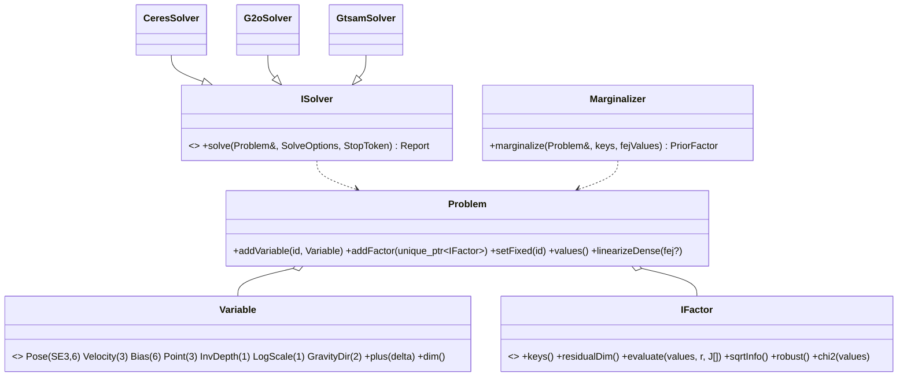

# 03 — 백엔드 설계 (워커 스레드)

> 핵심 결정: **factor가 수식을 소유, 솔버는 어댑터**(`분석/10` §1·§8). 이로써 Ceres(1차)·g2o·GTSAM을 같은 `Problem`으로 풀 수 있고, marginalization·FEJ를 라이브러리와 무관하게 구현하며, 모든 Jacobian을 수치 미분과 대조하는 단위 테스트를 둔다.

## 1. 그래프 추상 (`src/backend/graph/`)

### 1.1 변수(Variable)와 manifold
| 종류 | 표현 | 증분 | 비고 |
|---|---|---|---|
| `Pose` | `Sophus::SE3d T_wb` | **우측 곱** `T ← T·exp(δ)`, δ=[ρ, φ] (body frame) | ORB `ImuCamPose::Update`와 동일 관례; 카메라 pose는 `T_wc = T_wb·T_bc` 파생. 규약을 **하나로 통일**(`분석/05` §3-1) |
| `Velocity` | `Vector3d v_w` | 가법 | |
| `Bias` | `Vector6d [b_g, b_a]` | 가법 | ORB의 3+3 분리 정점을 6-D 하나로(`분석/05` §3-4) |
| `Point` | `Vector3d X_w` | 가법 | 정본 |
| `InvDepth` | `double ρ` (anchor KF, 픽셀 u,v 고정) | 가법 | BA 파라미터화 전용(OV²SLAM), 결과는 XYZ로 환원 |
| `LogScale` | `double σ`, `s = exp(σ)` | 가법 | ORB `VertexScale`의 "승산 갱신 vs 가산 Jacobian" 불일치 결함(ORB_SLAM3_Modern P6-3 실측: s*≥2 발산)을 **정의로 제거** — 잔차 Jacobian은 항상 `∂r/∂σ = ∂r/∂s·s` |
| `GravityDir` | `SO3 R_wg`, 2-DoF 증분 `exp([δ1, δ2, 0])` | 좌측 | ORB `VertexGDir` |

### 1.2 Factor 목록 (`분석/05` 대응표의 MVSLAM 열)
| Factor | 잔차 | 키 | 비고 |
|---|---|---|---|
| `ReprojectionFactor` | 2 (u,v) | Pose(host), Point | 카메라 `cam_idx`, `ICameraModel::projectJac`; Σ = 관측 info |
| `AnchoredInvDepthFactor` | 2 | Pose(anchor), Pose(obs), InvDepth | anchor 자신의 관측은 잔차 없음; 우측 카메라 관측은 `cam_idx`로 같은 factor |
| `ReprojectionPoseOnlyFactor` | 2 | Pose | motion-only, 점은 상수 |
| `ImuFactor` | 9 (Δr, Δv, Δp) | Pose_i, Vel_i, Bias_i, Pose_j, Vel_j | ORB `EdgeInertial` 수식(`분석/10` §7), 정보 = `C⁻¹` PSD 사영; **재적분 임계** 옵션(cuVSLAM) |
| `ImuScaleGravityFactor` | 9 | + LogScale, GravityDir | 초기화 전용(ORB `EdgeInertialGS`); scale은 위치·속도 차에만 곱함 |
| `BiasRandomWalkFactor` | 6 | Bias_i, Bias_j | 정보 = RW 공분산⁻¹ |
| `BiasPriorFactor` | 6 | Bias | 초기화 staged prior(1e2/1e10·1e5 → 1/1e5 → 0) |
| `PriorFactor` | n | 임의 키 집합 | marginalization 결과: `r = L·(x ⊟ x0)`, `H = LᵀL`(PSD 사영, FEJ x0) |
| `RelativePoseSE3Factor` | 6 | Pose_i, Pose_j | PGO(stereo·rgbd·VI 4-DoF 변형) — `(I+½ad)·Adj` Jacobian(OV²SLAM) |
| `RelativePoseSim3Factor` | 7 | Sim3_i, Sim3_j | mono PGO(essential graph, 정보 I) |
| `Yaw4DofFactor` | 6 | Pose_i, Pose_j | roll/pitch 증분 0(ORB 4DoF) |
| `Sim3ReprojectionFactor` | 2 | Sim3 | loop 검증 양방향(ORB `OptimizeSim3`) |

각 factor는 **해석 Jacobian**을 구현하고 `tests/unit/test_factor_jacobians.cpp`가 수치 미분(중앙차분)과 1e-6 상대오차로 대조한다. `robust()`는 `{None, Huber(δ), Cauchy}`; 관성 factor는 기본 None(ORB·DM-VIO 관례), 경계 factor만 Huber √16.92 + 정보 ×1e-2(ORB LocalInertialBA).

### 1.3 솔버 어댑터 (`src/backend/solvers/`)
| 어댑터 | 매핑 | 구성 |
|---|---|---|
| `CeresSolver`(1차, 필수) | `IFactor` → `ceres::CostFunction`(동적 크기, `Evaluate`가 `evaluate` 호출), `Pose` → `ceres::Manifold`(SE3 우측 증분, `PlusJacobian=[I;0]` 방식), `LogScale/GravityDir` → Manifold; 고정 키 → `SetParameterBlockConstant`; 점 → `ParameterBlockOrdering` group 0 | `SPARSE_SCHUR`/`DENSE_SCHUR`/`DENSE_QR`/`SPARSE_NORMAL_CHOLESKY` 선택, LM, `max_solver_time`, `IterationCallback`으로 `StopToken` 반영, `LossFunctionWrapper` → `Reset(nullptr)` 2-pass |
| `G2oSolver`(옵션) | `IFactor` → `g2o::BaseMultiEdge<Dynamic>`(`computeError`/`linearizeOplus`가 `evaluate` 호출), `Variable` → `BaseVertex<D, T>` | `BlockSolverX` + `LinearSolverEigen`, LM/GN, `setForceStopFlag` |
| `GtsamSolver`(옵션) | `IFactor` → `gtsam::NonlinearFactor` 파생(`linearize`가 `evaluate`로 `JacobianFactor` 구성), `Variable` → `Values`(Pose3·Vector·custom LieGroup) | `LevenbergMarquardtOptimizer`; `Marginals`로 공분산 질의 가능 |
등가성 검증: 같은 `Problem`을 세 어댑터로 풀어 GT 복구 정확도(해석적 정답)로 판정, 어댑터 간 비교는 통계 봉투(ORB_SLAM3_Modern P12-G0-2 방법론).

### 1.4 Marginalizer (`src/backend/marginalization/`)
1. `Problem::linearizeDense(fej_values)`: 각 factor의 `evaluate`로 J,r → `H = ΣJᵀΣJ`, `b = ΣJᵀΣr`(marg 키 포함 factor만, Markov blanket).
2. 재배열(marg 키 먼저) → `sqrt(|diag|+10)` preconditioning → `H_mm⁺`(고유값 클램프 유사역행렬) → Schur → 대칭화 → PSD 사영(ORB `ConstraintPoseImu`·DM-VIO `computeSchurComplement` 동일 계보, `분석/10` §4-6).
3. 결과 `PriorFactor(keys, H, b, x0=fej)` — 이후 선형화점 이동은 `b − H·(x ⊟ x0)`.
사용처: (a) pose-inertial 추적의 직전 프레임 15-D prior(ORB), (b) VIO 전용 모드의 슬라이딩 윈도우(dm-vio; 옵션), (c) 관성 LBA 경계(현재는 ORB식 다운웨이트 — prior로 교체하는 것은 실험 항목).

## 2. Local BA (`src/backend/local_ba/`)
| 항목 | 설계 |
|---|---|
| 윈도우 전략 `IWindowSelector` | `CovisibilityWindow{max_kf=20}`: 현재 KF + covisible KF(공유 ≥ 15) 상위 N, 나머지 관측 KF 고정(ORB — **상한 추가**, `분석/00` "시각 LBA 상한 없음"); `CovScoreWindow{min_cov=25}`: OV²SLAM 정렬 순회 절단; `TemporalWindow{N=10, N_large=25, max_fixed_visual=200}`: 관성(ORB) |
| 점 파라미터화 | 기본 `AnchoredInvDepth`(anchor = 최초 관측 KF; 윈도우 밖 anchor면 XYZ) |
| 솔버 옵션 | `SPARSE_SCHUR`, LM, 시각 10 iter / 관성 10(large 4), **시간 상한 0.2 s**, `StopToken`(새 KF 도착 시 Mapper가 신호) |
| robust/outlier | Huber χ² 5.991(mono)/7.815(stereo) → 제거 → L2 재정련(옵션) → 2차 제거; 관성 factor kernel 없음 |
| 발산 감지 | 전후 robust χ² 비교, 악화 시 결과 폐기(ORB `LocalInertialBA`) |
| write-back | 최적화는 사본으로, 결과는 `Map::withWriteLock`에서 일괄 반영 + `changeEpoch++` + `MapPointsUpdated` 이벤트 |

## 3. Mapper (`src/backend/mapper/`)
- `Triangulator`: temporal(가장 오래된 관측 KF 기준 DLT, cos-parallax < 0.9998, 양측 χ² 5.991/7.8, 스케일 일관성) + 깊이 소스(stereo/rgbd) 즉시 MP.
- `LocalMapMatcher`: 로컬맵 MP 투영(2 px) + descriptor 최소거리(≤ 0.2×256 bit) + ratio 0.9 → 트랙 병합(`MapPoint::merge`) — 끊긴 KLT 트랙 재연결(drift 억제). 새 KF 도착 시 조기 종료.
- `MapPointCuller`: found ratio < 0.25 또는 생성 후 2 KF 내 관측 ≤ 2(mono)/3 → tombstone.
- `KeyframeCuller`: 점의 90%(stereo-I 50%)가 다른 ≥ 3 KF에서 같거나 fine 스케일로 관측 → 제거; 관성: 최근 2 KF 보호, 병합 후 간격 < 3 s(초기화 후 0.5 s), preintegration `mergePrevious`(재적분); **anchor 이전**은 `MapPoint::onKeyframeRemoved`에서 다음 관측 KF로(OV²SLAM `removeKfObs`).

## 4. IMU (`src/backend/imu/`)
- `Preintegrator`(double): ORB `IntegrateNewMeasurement` 수식 — ΔP→ΔV→ΔR 순, 9×9 공분산 + 6×6 RW, bias Jacobian 5종, `deltaWithBias(b)` 1차 보정, `reintegrate()`(bias 변화 > 임계 시 자동 — cuVSLAM), `mergePrevious()`. 원시 측정 보관(직렬화·재적분용).
- `ImuInitializer`(State 패턴, `분석/08` §1 + `분석/01` §3.4):

```mermaid
stateDiagram-v2
  [*] --> Uninitialized
  Uninitialized --> CoarseInit : KF ≥ 10 && span ≥ (mono 2 s | stereo 1 s)
  CoarseInit --> Initialized : inertial-only MAP(pose 고정; v, b, R_wg, s) 성공 && var(s) < θ_init(mono) / 즉시(stereo·rgbd, s≡1)
  CoarseInit --> Uninitialized : 움직임 부족(dist<0.02 m, t<10 s) → 맵 리셋
  Initialized --> Refine1 : t > 5 s (prior 1 / 1e5)
  Refine1 --> Refine2 : t > 15 s (prior 0 / 0, KF별 bias + RW)
  Refine2 --> Done
  Initialized --> ScaleRefine : mono, 매 10 s(25~45 s), var(s) 감소 시만 채택
```

  - 초기값: v = 위치차/Δt, g 방향 = ΔV 누적(ORB), s = 1, b = 0.
  - 판정 지표를 시간이 아니라 **scale marginal variance**(dm-vio)로 두되 ORB의 staged prior 스케줄(1e2/1e10·1e5 → 1/1e5 → 0/0)을 유지한다. stereo·rgbd는 `LogScale` 고정.
  - 성공 시 `Map::applyScaledRotation(s, R_wg)`(전 KF pose·속도·MP 일괄) → `Map::changeEpoch++` → VI-BA(공유 bias, 100 iter) → spanning tree로 미최적화 KF 전파.
- `PoseInertialOptimizer`(프론트엔드 `IPoseOptimizer` 구현): 15-D 프레임 상태 + 시각 pose-only factor + `ImuFactor` + `BiasRandomWalkFactor` + 직전 프레임 `PriorFactor`(또는 마지막 KF 고정), GN 4×10 회차별 outlier 재분류, 종료 시 `Marginalizer`로 다음 프레임 prior 생성(KF 승격 시 prior 폐기 — ORB `mpcpi` 누수 없음: `unique_ptr`).

## 5. 루프 클로징 (`src/backend/loop/`)
| 단계 | 설계 | 근거 |
|---|---|---|
| 후보 | `IPlaceRecognizer::query(kf) → candidates`(현재 KF covisible 제외, 최근 p KF 제외); 구현 1: `DBoW3Adapter`(오프라인 어휘, ORB descriptor) / 구현 2(후순위): `IncrementalBinaryVocabulary`(iBoW-LCD식 온라인) | `분석/02` §3.4 |
| 검증 `LoopVerifier` | ① covisibility 공유 > 30이면 배제 → ② descriptor kNN ratio ≥ 15 → ③ 5-pt E ≥ 10 → ④ P3P ≥ 5 → ⑤ 로컬맵 재투영 + `MotionOnlyBa` ≥ 30 → ⑥ **공간 3표**(현재 KF covisible을 같은 변환으로 투영, 30매치=1표) + 시간 연속(가설 이월, 실패 2회 폐기) → ⑦ 관성 게이트(roll/pitch < 0.008 rad, scale 0.9~1.1) | OV²SLAM 5단 ∪ ORB 3표 |
| 보정 `ILoopCorrector` | mono: `Sim3Corrector`(Horn 3점 RANSAC + `Sim3ReprojectionFactor` 정련, ρ/s), stereo·rgbd: `Se3Corrector`, 관성 초기화 후: `Yaw4DofCorrector`. 현재 KF covisible 윈도우 전파 → MP 병합(구 쪽 생존) → 새 covisibility 링크만 loop edge | ORB `CorrectLoop` |
| PGO | essential graph(spanning tree + loop edge + 공유 ≥ 100 간선 + 관성 시간 간선) 위 `RelativePose{Sim3,SE3,Yaw4Dof}Factor`, `SPARSE_NORMAL_CHOLESKY` LM 20 iter, loop KF 고정; PGO 후 MP는 anchor KF 보정으로 이동(anchored) 또는 역투영/재투영(XYZ) | ORB·OV²SLAM |
| loose BA | 루프 오차 ≥ 0.02일 때만, loop KF covisible 시작~현재 KF 구간 BA 5 iter | OV²SLAM |
| GBA(옵션) | `!inertial || (KF < 200 && 맵 1개)`일 때만, 별도 작업으로 실행, 결과는 `PosesCorrected`로 **지연 적용**(Optimizer 워커 정지 후 spanning tree 전파) | ORB |
| 맵 병합 | 다른 맵 KF가 후보면 병합: 관성은 `RigidSnapMerge`(전체 rigid 스냅 + 국소 관성 BA, essential graph 생략), 시각은 `WeldingMerge`(welding BA + essential graph). 항상 **현재 맵이 죽고 old 맵 생존**, id 승계 | ORB MergeLocal/2 |

## 6. 문제별 솔버 구성표 (기본값)
| 문제 | 변수 | 선형 solver | 알고리즘 / λ₀ | 반복 / 상한 | robust |
|---|---|---|---|---|---|
| MotionOnlyBa | Pose 1 | DENSE_QR | LM | 5 / 5 ms → 2-pass | Huber √5.9915 |
| PoseInertial | Pose+Vel+Bias 2 | DENSE | GN | 4×10 | 시각만 Huber |
| LocalBA(visual) | ≤ 20 KF + MP | SPARSE_SCHUR | LM | 10 / 0.2 s | Huber → L2 |
| LocalBA(inertial) | 10(25) KF ×15-D + ≤200 고정 | SPARSE_SCHUR | LM 1e-2 | 10(4) / 0.2 s | 시각 Huber, 경계 관성 √16.92 |
| InertialInit | v, b, σ, R_wg | DENSE | LM 1e3 | 200 | 없음 |
| ScaleRefine | σ, R_wg | DENSE | GN | 10 | Huber 1.0 |
| PGO | KF pose | SPARSE_NORMAL_CHOLESKY | LM | 20 | 없음 |
| LooseBA / GBA | 구간 / 전체 | SPARSE_SCHUR | LM | 5 / 10~100 | Huber → L2 |
| Sim3 검증 | Sim3 1 | DENSE | LM | 5+n | Huber |
λ₀·반복·δ는 소스 상수가 아니라 `internals.yaml`(전문가 노브)에 둔다(ORB의 하드코딩 반면교사).

## 7. 테스트 계획
- factor별 Jacobian 수치 대조(전수), `Marginalizer` vs 해석적 Gaussian 정답, `Preintegrator` 등가속 체인 GT 복원(ORB_SLAM3_Modern `ImuKfChainFixture` 방법론 재사용), `ImuInitializer` 상태 전이표, 솔버 어댑터 GT 복구 봉투, LBA 시간 상한·선점 동작(StopToken) 테스트, PGO 합성 루프(원형 궤적 drift 보정) 테스트.
