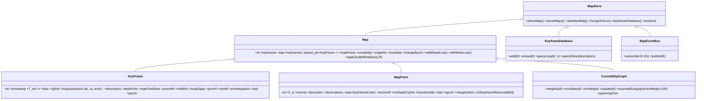

# 04 — 맵 계층: 데이터 모델, 소유권, 이벤트, 직렬화

> ORB-SLAM3 Atlas의 5요소(전역 id·단일 KFDB·맵 간 오염 차단·welding 이관·soft-delete)를 계승하되(`분석/01` §4-5), soft-delete 무회수는 **epoch 기반 회수**로, 포인터 그래프는 **id 기반 참조**로 바꾼다(VIGIL 원칙, ORB_SLAM3_Modern 소유권 교훈).

## 1. 식별자와 소유권
| 타입 | 정의 | 규칙 |
|---|---|---|
| `KeyframeId`, `MapPointId`, `MapId`, `TrackId` | `uint64_t` strong typedef(`core/ids.hpp`) | **전역 단조 증가**, 맵 경계를 넘어 유일. 저장 시 카운터 값을 함께 저장해 세션 재개 시 충돌 없음(ORB `nNextId` 5종 저장) |
| `KeyFrame` | `Map`이 `shared_ptr`로 소유 | 다른 객체는 **id로만 참조**(`MapPoint::observations: map<KeyframeId, ObsSlot>`, spanning tree·loop edge·prev/next KF 전부 id). 포인터 dangling 원천 제거, 직렬화 = 필드 그대로 |
| `MapPoint` | `Map`이 `shared_ptr`로 소유 | KF는 `vector<MapPointId>`(트랙 슬롯 인덱스 = 관측 인덱스) |
| 삭제 | `markBad()` → tombstone(즉시 그래프에서 분리) → `Map::reclaim(epoch)`이 **참조 epoch가 지난 tombstone을 실제 해제** | ORB의 "delete 없음 = 무한 누적" 대신 상한 보장. 워커는 자기 epoch를 `Map`에 등록(읽기 시작/끝) |
| `Frame` | 프론트엔드 내부, 값 타입 | KF 승격 시 필요한 필드만 복사 |

## 2. 클래스

- `CovisibilityGraph::update(kf)`: 공유 MP 수 집계(**같은 맵 KF만**, ORB `GetMap()` 필터), 가중치 ≥ 15 간선, 첫 연결 시 최대 공시 KF를 spanning tree 부모로. `essentialSubgraph`: spanning tree + loop edge + 가중 ≥ 100(+관성 prev/next 간선).
- `KeyFrame::keypoints`: `vector<Keypoint{uv, uv_undist, level(0 for KLT), track_id}>`, `descriptors: cv::Mat`은 **map 모듈 밖 타입이라 `std::vector<uint8_t>`(N×32) + stride**로 저장(공개 헤더·직렬화 독립).
- `MapPoint::observations`의 값은 `{slot_index, cam_index}` — fisheye/다중 카메라의 좌/우 관측을 같은 KF 안에서 구분(ORB tuple<left,right> 일반화).

## 3. 다중 맵(MapStore, Atlas-lite)
| 동작 | 규칙 |
|---|---|
| `startNewMap()` | 프론트엔드 LOST && 현재 맵 KF > 10. 현재 맵은 `stored`, 새 맵 `active`; id 공간은 계속 증가 |
| 병합 | Loop 워커가 stored 맵 KF를 후보로 검증 성공 시: `merge(current → stored)` — **현재 맵이 죽고 stored 맵이 살며 id 승계**(ORB). 관성은 rigid 스냅 + 국소 BA, 시각은 welding BA + essential graph([03-backend.md](03-backend.md) §5) |
| bad map | `merge` 후 원 맵은 tombstone → 참조 epoch 만료 시 해제(ORB `RemoveBadMaps` delete 주석 처리의 반대) |
| KFDB | **하나**, 모든 맵 KF 포함(loop·merge·reloc 후보를 한 질의로). reloc은 active 맵 한정이 아니라 전 맵(개선) |
| IMU 상태 | 맵별 `imuState{initialized, ba1, ba2, scale, R_wg}` — 새 맵은 처음부터 초기화, 병합 시 성숙한 쪽 승계 |

## 4. 동시성 계약 (상세 [06-concurrency.md](06-concurrency.md))
- `Map`은 `std::shared_mutex` 하나(coarse)로 보호: 프론트엔드는 **shared lock 아래 스냅샷 복사**(로컬맵 MP id·위치·descriptor), 워커의 write-back은 짧은 unique lock. 최적화 연산 자체는 락 밖(ORB copy-out/write-back 패턴 `분석/01` 인용 VIGIL 분석 2.3절).
- 객체 필드에 개별 mutex를 두지 않는다(ORB KeyFrame 4개·MapPoint 3개 mutex의 락 순서 부담 제거). 대신 "쓰기는 Map write lock 안에서만"을 불변식으로 두고 디버그 빌드에서 `assertWriteLocked()`로 검사.
- `changeEpoch`(atomic)는 write-back마다 증가; 프론트엔드는 프레임마다 비교해 `map_updated` 판정(ORB `mnMapChange`).

## 5. 이벤트 (Observer, dense mapping 훅 — `분석/07` §7.1 답)
| 이벤트 | 페이로드 | 발행 시점 |
|---|---|---|
| `KeyframeInserted` | `kf_id, timestamp, T_wb, depth/stereo 원본 참조(옵션)` | Mapper write-back 후 |
| `KeyframeRemoved` | `kf_id` | culling 후 |
| `MapPointsUpdated` | `map_id`(대량이라 id 목록 대신 epoch) | LBA write-back 후 |
| `PosesCorrected` | `map_id, vector<{kf_id, T_wb_old, T_wb_new}>` | PGO/GBA/merge/IMU init 적용 후 — **submap rigid 이동에 필요한 정보 전부** |
| `MapMerged` / `MapReset` / `LoopClosed` / `ImuInitialized` | 각 id·변환 | |
- 콜백은 발행 워커 스레드에서 **락 밖**에서 호출된다. 구독자는 즉시 반환해야 하며(큐잉만), 예외는 로깅 후 삼킨다(호스트를 죽이지 않음).
- 관측 비용 0: 구독자가 없으면 페이로드를 만들지 않는다(`bus.hasSubscribers<E>()`).

## 6. 직렬화 (`map/serialization/`, cereal binary)
| 항목 | 저장 | 비고 |
|---|---|---|
| 헤더 | magic, format version, `mvslam` 버전, rig 해시, 어휘 해시(DBoW 사용 시), id 카운터 4종 | 불일치 시 로드 거부(마이그레이션은 버전별 reader) |
| Map | id, origin KF ids, imuState, KF 목록, MP 목록(tombstone 제외) | |
| KeyFrame | id, timestamp, `T_wb`, v, bias, rig 인덱스, keypoints(uv_undist, level, track_id), descriptors, depth 관측, MP slot ids, covisibility(id, weight), spanning tree/loop edge ids, prev/next KF, preintegration(Δ, Jacobian, 공분산, **원시 측정 포함**) | 이미지·피라미드 미저장 |
| MapPoint | id, X_w, normal, descriptor, observations(kf id → slot, cam), anchor kf, 거리 범위, counters | |
| 미저장 | KFDB 역색인(로드 시 재구축), 프레임 궤적, 임시 스탬프 | |
- 로드: 전 맵을 `stored`로 등록 + KFDB 재구축 → 새 active 맵 시작 → 재측위 성공 시 그 맵을 active로 전환하고 IMU 상태 승계(ORB의 "병합으로 승계"보다 직접적).
- 포맷은 플랫폼 독립(리틀엔디언 고정, 정수 폭 고정). Python 도구(`scripts/mapdump.py`)로 검사 가능하도록 필드 순서를 문서화한다.

## 7. 메모리 상한
- 맵당 KF 상한(`map.max_keyframes`, 기본 무제한 → culling 강도로 제어), stored 맵 수 상한(초과 시 가장 오래된 맵을 디스크로 spill), descriptor lazy-load 옵션(cuVSLAM `map_cache_path`), epoch 회수. 상시 구동 시 메모리가 단조 증가하지 않음을 통합 테스트(장시간 루프 시퀀스)로 검증한다.
